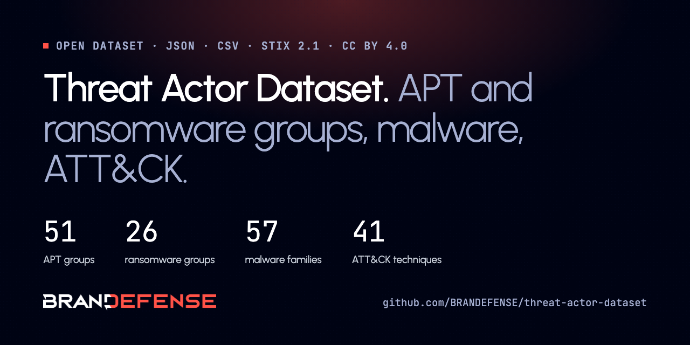
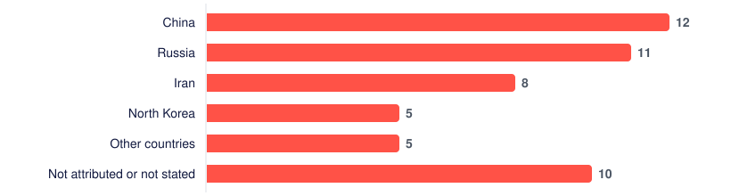
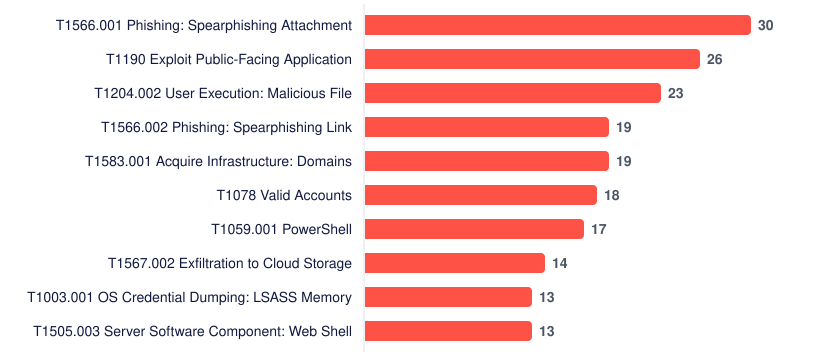

<p align="center"></p>

# Threat Actor Dataset: APT groups, ransomware groups, malware and MITRE ATT&CK techniques

An open, machine-readable dataset of **52 APT groups, 26 ransomware groups, 58 malware families and 41 MITRE ATT&CK techniques**: aliases, suspected origin, targets, tools, ATT&CK techniques (TTPs) and the public sources each entry is written from. Free to use under CC BY 4.0.

   

Maintained by the [Brandefense](https://brandefense.io) Research Team. Every entry is written from public primary sources (government advisories, MITRE ATT&CK, vendor research) and links to them.

## What is in this dataset

| Dataset | Entries | Files |
|---|---:|---|
| APT groups | 52 | [`data/apt-groups.json`](data/apt-groups.json) · [`data/apt-groups.csv`](data/apt-groups.csv) |
| Ransomware groups | 26 | [`data/ransomware-groups.json`](data/ransomware-groups.json) · [`data/ransomware-groups.csv`](data/ransomware-groups.csv) |
| Malware families | 58 | [`data/malware.json`](data/malware.json) · [`data/malware.csv`](data/malware.csv) |
| MITRE ATT&CK techniques | 41 | [`data/attack-techniques.json`](data/attack-techniques.json) · [`data/attack-techniques.csv`](data/attack-techniques.csv) |

Each entry also has a readable page in this repository (linked in the tables below) and a full profile on [brandefense.io](https://brandefense.io/knowledge-hub/apt-groups/). A STIX 2.1 bundle of the whole dataset is in [`data/stix/threat-actors.stix.json`](data/stix/threat-actors.stix.json).

## At a glance

**APT groups by suspected state link.** Count of APT groups in the dataset by the country the sources link them to.

<picture><source media="(prefers-color-scheme: dark)" srcset="assets/origin-dark.svg"></picture>

**Most common ATT&CK techniques.** Number of APT and ransomware groups in the dataset that use each technique.

<picture><source media="(prefers-color-scheme: dark)" srcset="assets/techniques-dark.svg"></picture>


## Quick start

```bash
# all entries as JSON
curl -s https://raw.githubusercontent.com/BRANDEFENSE/threat-actor-dataset/main/data/apt-groups.json | jq '.meta'
# example query
curl -s https://raw.githubusercontent.com/BRANDEFENSE/threat-actor-dataset/main/data/apt-groups.json | jq -r '.items[] | select(.suspected_origin=="North Korea") | .name'
```

```python
import json, urllib.request
data = json.load(urllib.request.urlopen("https://raw.githubusercontent.com/BRANDEFENSE/threat-actor-dataset/main/data/apt-groups.json"))
for item in data["items"]:
    print(item["name"], item["url"])
```

The raw file URLs above are stable. The STIX bundle loads into OpenCTI, MISP (STIX import) and any STIX 2.1 tool.

## Fields

| Field | Meaning |
|---|---|
| `name`, `slug`, `url` | Name, stable id and the full profile on brandefense.io |
| `aliases` | Other names, each with the vendor or agency that uses it (APT) |
| `summary` | Two to three sentence description |
| `suspected_origin`, `attributed_by` | Country the group is linked to, and who made that attribution |
| `mitre_attack_id` | ATT&CK group id (Gxxxx) or technique id (Txxxx) |
| `target_sectors`, `target_regions` | Sectors and regions named in the sources |
| `attack_techniques` | List of `{tactic, id, name}` ATT&CK techniques |
| `tools` / `malware` / `used_by` | Tools and malware a group uses, and groups that use a malware family |
| `status`, `first_seen`, `model`, `extortion` | Ransomware group status (active, disrupted, inactive, rebranded) and business model |
| `type`, `platforms` | Malware type and platforms |
| `sources` | `{title, publisher, url}` for every public source used |
| `last_updated` | Date the entry was last reviewed |

Each JSON file has a `meta` block (`dataset`, `publisher`, `license`, `generated`, `count`) and an `items` list. CSV files hold the same rows; list fields are joined with `; `.

## APT groups

| Group | Also known as | Suspected origin | ATT&CK |
|---|---|---|---|
| [Andariel](apt-groups/andariel.md) | Silent Chollima, PLUTONIUM, Onyx Sleet, … | North Korea | G0138 |
| [APT-C-60](apt-groups/apt-c-60.md) |  |  |  |
| [APT1](apt-groups/apt1.md) | Comment Crew, Comment Group, Comment Panda | China | G0006 |
| [APT18](apt-groups/apt18.md) | TG-0416, Dynamite Panda, Threat Group-0416, … |  | G0026 |
| [APT19](apt-groups/apt19.md) | Codoso, C0d0so0, Codoso Team, … | China | G0073 |
| [APT27](apt-groups/apt27.md) | Threat Group-3390, TG-3390, Emissary Panda, … | China | G0027 |
| [APT28](apt-groups/apt28.md) | Fancy Bear, Forest Blizzard, Sofacy, … | Russia | G0007 |
| [APT29](apt-groups/apt29.md) | Cozy Bear, The Dukes, Midnight Blizzard, … | Russia | G0016 |
| [APT32](apt-groups/apt32.md) | OceanLotus, SeaLotus, APT-C-00, … | Vietnam | G0050 |
| [APT33](apt-groups/apt33.md) | HOLMIUM, Elfin, Peach Sandstorm, … | Iran | G0064 |
| [APT34](apt-groups/apt34-oilrig.md) | OilRig, COBALT GYPSY, IRN2, … | Iran | G0049 |
| [APT35](apt-groups/apt35-charming-kitten.md) | Magic Hound, TA453, COBALT ILLUSION, … | Iran | G0059 |
| [APT36](apt-groups/apt36-transparent-tribe.md) | Transparent Tribe, COPPER FIELDSTONE, Mythic Leopard, … | Pakistan | G0134 |
| [APT37](apt-groups/apt37.md) | ScarCruft, InkySquid, Reaper, … | North Korea | G0067 |
| [APT38](apt-groups/apt38.md) | Bluenoroff, Stardust Chollima, NICKEL GLADSTONE, … | North Korea | G0082 |
| [APT39](apt-groups/apt39.md) | Advanced Persistent Threat 39, Chafer, ITG07, … | Iran | G0087 |
| [APT40](apt-groups/apt40.md) | Leviathan, MUDCARP, Kryptonite Panda, … | China | G0065 |
| [APT41](apt-groups/apt41.md) | Wicked Panda, Brass Typhoon, BARIUM, … | China | G0096 |
| [APT42](apt-groups/apt42.md) | TA453, Mint Sandstorm, Educated Manticore, … | Iran | G1044 |
| [ARMORY CASTLE](apt-groups/armory-castle.md) | UNC5221 | China (suspected) |  |
| [BITTER](apt-groups/bitter.md) | T-APT-17 |  | G1002 |
| [BlackTech](apt-groups/blacktech.md) | Palmerworm, Temp.Overboard, Circuit Panda, … | China | G0098 |
| [CyberAv3ngers](apt-groups/cyberav3ngers.md) | CyberAveng3rs, Cyber Avengers, Shahid Kaveh Group, … | Iran | G1027 |
| [Dragonfly](apt-groups/dragonfly.md) | TEMP.Isotope, DYMALLOY, Berserk Bear, … | Russia | G0035 |
| [Ember Bear](apt-groups/ember-bear.md) | Cadet Blizzard, UAC-0056, UNC2589, … | Russia | G1003 |
| [FIN7](apt-groups/fin7.md) | Navigator Group, GOLD NIAGARA, Carbon Spider, … |  | G0046 |
| [Gamaredon](apt-groups/gamaredon.md) | Gamaredon Group, IRON TILDEN, Primitive Bear, … | Russia | G0047 |
| [HAFNIUM](apt-groups/hafnium.md) | Silk Typhoon | China | G0125 |
| [Handala](apt-groups/handala.md) | Handala Hack, Handala Hack Team | Iran | G1055 |
| [Indrik Spider](apt-groups/indrik-spider.md) | Evil Corp, Manatee Tempest, DEV-0243, … | Russia | G0119 |
| [k0t Threat Actor: Edge Device Campaign Against FortiGate and GlobalProtect](apt-groups/k0t.md) | k0t, CryptoFeel, Member19 | Not stated in the sources |  |
| [Kimsuky](apt-groups/kimsuky.md) | Black Banshee, Velvet Chollima, Emerald Sleet, … | North Korea | G0094 |
| [LAPSUS$](apt-groups/lapsus.md) | DEV-0537, Strawberry Tempest, Lapsus Group | Based mainly in the United Kingdom and Brazil, per the US Cyber Safety Review Board | G1004 |
| [LAUNDRY BEAR](apt-groups/laundry-bear.md) | Void Blizzard, CL-STA-1114, TA488 | Russia |  |
| [Lazarus Group](apt-groups/lazarus-group.md) | HIDDEN COBRA, Guardians of Peace, Labyrinth Chollima, … | North Korea | G0032 |
| [menuPass](apt-groups/menupass.md) | APT10, Stone Panda, Red Apollo, … | China | G0045 |
| [MirrorFace](apt-groups/mirrorface.md) | Earth Kasha |  | G1054 |
| [MuddyWater](apt-groups/muddywater.md) | Earth Vetala, MERCURY, Static Kitten, … | Iran | G0069 |
| [Mustang Panda](apt-groups/mustang-panda.md) | TA416, RedDelta, BRONZE PRESIDENT, … | China | G0129 |
| [Salt Typhoon](apt-groups/salt-typhoon.md) | OPERATOR PANDA, RedMike, GhostEmperor, … | China | G1045 |
| [Sandworm](apt-groups/sandworm.md) | Sandworm Team, Telebots, Voodoo Bear, … | Russia | G0034 |
| [Scattered Spider](apt-groups/scattered-spider.md) | Roasted 0ktapus, Octo Tempest, Storm-0875, … | Not attributed to a state | G1015 |
| [ShinyHunters](apt-groups/shinyhunters.md) | UNC6240, Bling Libra | Not stated in the sources opened | G1057 |
| [SideWinder](apt-groups/sidewinder.md) | Sidewinder, T-APT-04, Rattlesnake, … | India | G0121 |
| [Silent Lynx](apt-groups/silent-lynx.md) | UAT-6275, TAG-193 | Kazakhstan (suspected) |  |
| [Star Blizzard](apt-groups/star-blizzard.md) | SEABORGIUM, Callisto Group, TA446, … | Russia | G1033 |
| [TA505](apt-groups/ta505.md) | CL0P, Hive0065, Spandex Tempest, … |  | G0092 |
| [TeamPCP](apt-groups/teampcp.md) | PCPCat, ShellForce, DeadCatx3, … |  | G1056 |
| [Turla](apt-groups/turla.md) | Waterbug, Venomous Bear, Snake, … | Russia | G0010 |
| [UNC3886](apt-groups/unc3886.md) |  |  | G1048 |
| [Volt Typhoon](apt-groups/volt-typhoon.md) | Vanguard Panda, BRONZE SILHOUETTE, DEV-0391, … | China | G1017 |
| [Wizard Spider](apt-groups/wizard-spider.md) | Trickbot group, UNC1878, GOLD BLACKBURN, … | Russia | G0102 |

## Ransomware groups

| Group | Also known as | Status | First seen |
|---|---|---|---|
| [8Base](ransomware-groups/8base.md) | Affiliate 2803 | disrupted | 2019 |
| [Akira](ransomware-groups/akira.md) |  | active | 2023 |
| [ALPHV / BlackCat](ransomware-groups/alphv-blackcat.md) | ALPHV, BlackCat, Noberus | disrupted | 2021 |
| [BianLian](ransomware-groups/bianlian.md) |  | active | 2022 |
| [Black Basta](ransomware-groups/black-basta.md) |  |  | 2022 |
| [Cl0p](ransomware-groups/cl0p.md) | Clop | active | 2019 |
| [Conti](ransomware-groups/conti.md) |  | inactive | 2019 |
| [DarkSide](ransomware-groups/darkside.md) |  | inactive | 2020 |
| [DearCry](ransomware-groups/dearcry.md) |  |  | March 2021 |
| [DragonForce](ransomware-groups/dragonforce.md) |  | active | Not dated in official sources |
| [Everest](ransomware-groups/everest.md) |  | active | 2020 |
| [Hive](ransomware-groups/hive.md) |  | disrupted | 2021 |
| [Interlock](ransomware-groups/interlock.md) |  | active | 2024 |
| [KillSec](ransomware-groups/killsec.md) |  | disrupted | 2024 |
| [LockBit](ransomware-groups/lockbit.md) |  | disrupted | 2020 |
| [Lynx](ransomware-groups/lynx.md) |  | active |  |
| [Medusa](ransomware-groups/medusa.md) |  | active | 2021 |
| [Play](ransomware-groups/play.md) | Playcrypt | active | 2022 |
| [Qilin](ransomware-groups/qilin.md) | Agenda | active | 2022 |
| [RansomHub](ransomware-groups/ransomhub.md) |  |  | 2024 |
| [REvil](ransomware-groups/revil.md) | Sodinokibi, Sodin | disrupted | 2019 |
| [Rhysida](ransomware-groups/rhysida.md) |  | active | 2023 |
| [Royal](ransomware-groups/royal.md) |  | rebranded | 2022 |
| [SafePay](ransomware-groups/safepay.md) |  | active | 2024 |
| [Vice Society](ransomware-groups/vice-society.md) |  |  | 2021 |
| [Warlock](ransomware-groups/warlock.md) |  |  | 2025 |

## Malware

| Malware | Type | Platforms | Used by |
|---|---|---|---|
| [AcidRain](malware/acidrain.md) | wiper | Network Devices, Linux | Sandworm |
| [Akira](malware/akira.md) | ransomware | Windows |  |
| [Bad Rabbit](malware/bad-rabbit.md) | ransomware | Windows | Sandworm |
| [BARECLAW tunneler](malware/bareclaw.md) |  | Linux (BeyondTrust Remote Support appliance) |  |
| [Black Basta](malware/black-basta.md) | ransomware | Windows, ESXi |  |
| [BlackCat](malware/blackcat.md) | ransomware | Linux, Windows | Scattered Spider |
| [BlackEnergy](malware/blackenergy.md) | framework | Windows | Sandworm |
| [BRICKSTORM backdoor](malware/brickstorm.md) | rat | ESXi, Linux, Network Devices, Windows | ARMORY CASTLE |
| [CaddyWiper](malware/caddywiper.md) | wiper | Windows | Sandworm |
| [Candiru spyware](malware/candiru.md) |  | Windows |  |
| [CanisterWorm](malware/canisterworm.md) | infostealer | Containers, Linux | TeamPCP |
| [China Chopper](malware/china-chopper.md) | abused-tool | Windows | APT40, APT41, Mustang Panda |
| [Clop](malware/clop.md) | ransomware | Windows | Cl0p |
| [Cobalt Strike](malware/cobalt-strike.md) | abused-tool | Linux, macOS, Windows | APT29, APT40, APT41, … |
| [Conti](malware/conti.md) | ransomware | Windows |  |
| [Crimson RAT](malware/crimson-rat.md) | rat | Windows | APT36 |
| [CROSSROAD downloader](malware/crossroad.md) | loader | Windows |  |
| [Cyclops Blink](malware/cyclops-blink.md) | botnet | Network Devices | Sandworm |
| [Derusbi](malware/derusbi.md) | rat | Windows, Linux | APT40, APT41 |
| [Dtrack](malware/dtrack.md) | rat | Windows | Lazarus Group |
| [Emotet](malware/emotet.md) | loader | Windows |  |
| [Evilginx](malware/evilginx.md) | abused-tool | IaaS, Identity Provider, Office Suite, SaaS | LAUNDRY BEAR |
| [FASTCash](malware/fastcash.md) | rat | AIX, Windows | APT38, Lazarus Group |
| [Gh0st RAT](malware/gh0st-rat.md) | rat | Windows, macOS | Andariel, APT40, APT41, … |
| [GlassWorm Malware: From VS Code Extensions to the OVHcloud CLI Swap](malware/glassworm.md) | loader | macOS, Windows |  |
| [HOOKEDGE Backdoor](malware/hookedge.md) | rat | Windows | APT28 |
| [HOPLIGHT](malware/hoplight.md) | rat | Windows | APT38, Lazarus Group |
| [Impacket](malware/impacket.md) | abused-tool | Linux, macOS, Windows | APT29, APT35, APT41, … |
| [Industroyer](malware/industroyer.md) | framework | Windows | Sandworm |
| [Infamous Chisel](malware/infamous-chisel.md) | rat | Android | Sandworm |
| [Kazuar](malware/kazuar.md) | rat | Windows, macOS | Turla |
| [KV botnet](malware/kv-botnet.md) | botnet |  | Volt Typhoon |
| [LAPLAS implant](malware/laplas.md) | rat | Windows | Silent Lynx |
| [Mimikatz](malware/mimikatz.md) | abused-tool | Windows | APT1, APT28, APT29, … |
| [Mini Shai-Hulud](malware/mini-shai-hulud.md) | infostealer | Containers, IaaS, Linux, macOS, SaaS, Windows | TeamPCP |
| [NICECURL](malware/nicecurl.md) | rat | Windows | APT42 |
| [NotPetya](malware/notpetya.md) | wiper | Windows | Sandworm |
| [Olympic Destroyer](malware/olympic-destroyer.md) | wiper | Windows | Sandworm |
| [PEERSTITCH malware](malware/peerstitch.md) | loader | Linux (ARM64, FortiOS) |  |
| [PickleShell reverse shell](malware/pickleshell.md) | rat | Windows | Silent Lynx |
| [PlugX](malware/plugx.md) | rat | Windows | Mustang Panda, APT41, menuPass |
| [PoisonIvy](malware/poisonivy.md) | rat | Windows | APT1, menuPass, Mustang Panda |
| [RedLine Stealer](malware/redline-stealer.md) | infostealer | Windows |  |
| [REvil](malware/revil.md) | ransomware | Windows |  |
| [ROKRAT](malware/rokrat.md) | rat | Windows | APT37 |
| [ROMULUS ClickFix Delivery Platform: LegionLoader and Other Payloads](malware/romulus-clickfix.md) | framework | Windows |  |
| [SAWFLY web shell](malware/sawfly.md) |  | Linux (BeyondTrust Remote Support appliance) |  |
| [ShadowPad](malware/shadowpad.md) | rat | Windows | APT41, Mustang Panda |
| [Shai-Hulud](malware/shai-hulud.md) | framework | Linux, SaaS, Windows |  |
| [SHINYROAD backdoor](malware/shinyroad.md) | rat | Windows |  |
| [Snake (Uroburos)](malware/snake.md) | rat | Linux, Windows, macOS | Turla |
| [SUNBURST](malware/sunburst.md) | rat | Windows | APT29 |
| [TAMECAT](malware/tamecat.md) | rat | Windows | APT42 |
| [TeamPCP Cloud Stealer](malware/teampcp-cloud-stealer.md) | infostealer | Containers, Linux, macOS, SaaS, Windows | TeamPCP |
| [TruffleHog](malware/trufflehog.md) | abused-tool | IaaS, Linux, SaaS, Windows | TeamPCP |
| [Ulej](malware/ulej.md) | infostealer | Zimbra Collaboration Suite webmail, Docker | LAUNDRY BEAR |
| [VersaMem](malware/versamem.md) | rat | Network Devices | Volt Typhoon |
| [WannaCry](malware/wannacry.md) | ransomware | Windows | Lazarus Group |

## MITRE ATT&CK techniques

| ID | Technique | Tactic |
|---|---|---|
| T1003 | [OS Credential Dumping](attack-techniques/t1003-os-credential-dumping.md) | Credential Access |
| T1005 | [Data from Local System](attack-techniques/t1005-data-from-local-system.md) | Collection |
| T1021 | [Remote Services](attack-techniques/t1021-remote-services.md) | Lateral Movement |
| T1027 | [Obfuscated Files or Information](attack-techniques/t1027-obfuscated-files-or-information.md) | Stealth |
| T1036 | [Masquerading](attack-techniques/t1036-masquerading.md) | Stealth |
| T1041 | [Exfiltration Over C2 Channel](attack-techniques/t1041-exfiltration-over-c2-channel.md) | Exfiltration |
| T1053 | [Scheduled Task/Job](attack-techniques/t1053-scheduled-task-job.md) | Execution, Persistence, Privilege Escalation |
| T1055 | [Process Injection](attack-techniques/t1055-process-injection.md) | Stealth, Privilege Escalation |
| T1056 | [Input Capture](attack-techniques/t1056-input-capture.md) | Collection, Credential Access |
| T1057 | [Process Discovery](attack-techniques/t1057-process-discovery.md) | Discovery |
| T1059 | [Command and Scripting Interpreter](attack-techniques/t1059-command-and-scripting-interpreter.md) | Execution |
| T1068 | [Exploitation for Privilege Escalation](attack-techniques/t1068-exploitation-for-privilege-escalation.md) | Privilege Escalation |
| T1070 | [Indicator Removal](attack-techniques/t1070-indicator-removal.md) | Stealth |
| T1071 | [Application Layer Protocol](attack-techniques/t1071-application-layer-protocol.md) | Command and Control |
| T1078 | [Valid Accounts](attack-techniques/t1078-valid-accounts.md) | Stealth, Persistence, Privilege Escalation, Initial Access |
| T1082 | [System Information Discovery](attack-techniques/t1082-system-information-discovery.md) | Discovery |
| T1083 | [File and Directory Discovery](attack-techniques/t1083-file-and-directory-discovery.md) | Discovery |
| T1087 | [Account Discovery](attack-techniques/t1087-account-discovery.md) | Discovery |
| T1105 | [Ingress Tool Transfer](attack-techniques/t1105-ingress-tool-transfer.md) | Command and Control |
| T1112 | [Modify Registry](attack-techniques/t1112-modify-registry.md) | Defense Impairment, Persistence |
| T1133 | [External Remote Services](attack-techniques/t1133-external-remote-services.md) | Persistence, Initial Access |
| T1140 | [Deobfuscate/Decode Files or Information](attack-techniques/t1140-deobfuscate-decode-files-or-information.md) | Stealth |
| T1189 | [Drive-by Compromise](attack-techniques/t1189-drive-by-compromise.md) | Initial Access |
| T1190 | [Exploit Public-Facing Application](attack-techniques/t1190-exploit-public-facing-application.md) | Initial Access |
| T1195.002 | [Compromise Software Supply Chain](attack-techniques/t1195-002-compromise-software-supply-chain.md) | Initial Access |
| T1204 | [User Execution](attack-techniques/t1204-user-execution.md) | Execution |
| T1204.004 | [ClickFix: Malicious Copy and Paste (T1204.004)](attack-techniques/t1204-004-malicious-copy-and-paste.md) | Execution |
| T1486 | [Data Encrypted for Impact](attack-techniques/t1486-data-encrypted-for-impact.md) | Impact |
| T1497 | [Virtualization/Sandbox Evasion](attack-techniques/t1497-virtualization-sandbox-evasion.md) | Stealth, Discovery |
| T1505.003 | [Server Software Component: Web Shell (T1505.003)](attack-techniques/t1505-003-web-shell.md) | Persistence |
| T1546.018 | [Python Startup Hooks: .pth and sitecustomize.py Persistence (T1546.018)](attack-techniques/t1546-018-python-startup-hooks.md) | Persistence, Privilege Escalation |
| T1547 | [Boot or Logon Autostart Execution](attack-techniques/t1547-boot-or-logon-autostart-execution.md) | Persistence, Privilege Escalation |
| T1547.001 | [Registry Run Keys / Startup Folder](attack-techniques/t1547-001-registry-run-keys-startup-folder.md) | Persistence, Privilege Escalation |
| T1552.001 | [Credentials in Files: Stealing Secrets from Config Files (T1552.001)](attack-techniques/t1552-001-credentials-in-files.md) | Credential Access |
| T1555 | [Credentials from Password Stores](attack-techniques/t1555-credentials-from-password-stores.md) | Credential Access |
| T1560 | [Archive Collected Data](attack-techniques/t1560-archive-collected-data.md) | Collection |
| T1564 | [Hide Artifacts](attack-techniques/t1564-hide-artifacts.md) | Stealth |
| T1566 | [Phishing (T1566): ATT&CK Technique](attack-techniques/t1566-phishing.md) | Initial Access |
| T1573 | [Encrypted Channel](attack-techniques/t1573-encrypted-channel.md) | Command and Control |
| T1574.001 | [DLL](attack-techniques/t1574-001-dll.md) | Stealth, Execution |
| T1620 | [Reflective Code Loading](attack-techniques/t1620-reflective-code-loading.md) | Stealth |

## Update frequency

Snapshots are published as dated GitHub releases (`vYYYY.MM`). Each entry carries `last_updated`.

## Sources and method

Entries are written by the Brandefense Research Team from public primary sources: government and CERT advisories (CISA, FBI, NCSC, CERT-FR and others), MITRE ATT&CK, court filings, and research published by security vendors. Attribution is reported as the sources state it, with the attributing party named. Every entry lists the public sources it is written from.

## Corrections

Found an error or a missing source? [Open an issue](https://github.com/BRANDEFENSE/threat-actor-dataset/issues/new?template=data-correction.md) with the entry name and a public source. See [CONTRIBUTING.md](CONTRIBUTING.md).

## How to cite

Use the "Cite this repository" button (from [`CITATION.cff`](CITATION.cff)), or:

> Brandefense (2026). *Threat Actor Dataset* (version 2026.10). https://github.com/BRANDEFENSE/threat-actor-dataset

## License

Data and texts: [Creative Commons Attribution 4.0 International (CC BY 4.0)](LICENSE). You may share and adapt them for any purpose, including commercial use, if you credit **Brandefense** and link to this repository or to [brandefense.io](https://brandefense.io).

## About Brandefense

[Brandefense](https://brandefense.io) is an AI-driven threat intelligence platform that unifies Cyber Threat Intelligence, Digital Risk Protection and External Attack Surface Management. The same profiles, with timelines, defences and FAQ, are on the [Brandefense Knowledge Hub](https://brandefense.io/knowledge-hub/). Free tools: [ATLAS](https://atlas.brandefense.io).
